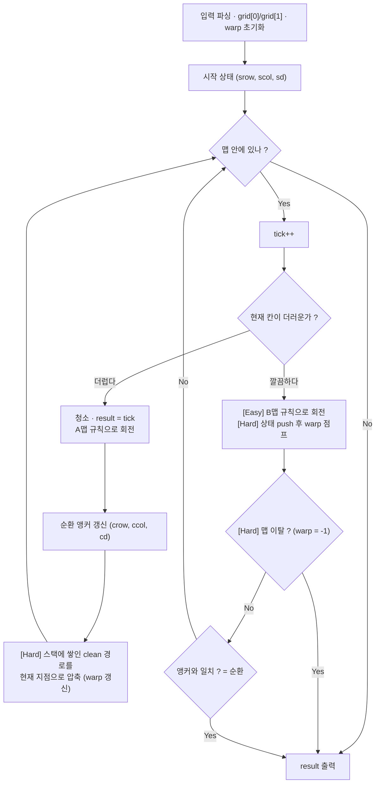

> **Easy** — [백준 31404 - 아리스, 청소합니다! (Easy)](https://www.acmicpc.net/problem/31404)
>
> **Hard** — [백준 31399 - 아리스, 청소합니다! (Hard)](https://www.acmicpc.net/problem/31399)
{: .prompt-info }

> 문제 미리보기 이미지는 BOJ 문제 페이지 이용이 가능해지면 업데이트할 예정이다.
{: .prompt-info }

## 요약

이 문제는 Easy와 Hard로 난이도가 나뉜다. Easy는 크게 두 가지를 할 줄 알아야 된다: 구현과 순환 감지. Hard는 맵 크기가 $64 \times 64$에서 $1{,}024 \times 1{,}024$로 커지면서 (한 변 기준 16배, 칸 수 기준 256배) 추가적인 최적화인 경로 압축 (Path Compression)이 필요하다. 즉, 한 번 탐색했던 경로를 다시 계산하지 않는 것이다.

## 문제풀이

### 1. 시각화


_시뮬레이션 흐름 (앵커 = 마지막으로 청소한 직후 상태, [Hard] 표시는 Hard 전용 최적화)_

### 2. 자료구조 및 입력받기

```cpp
int height, width;
int srow, scol, sd;
int result = 0;
vector<vector<vector<int>>> grid;
vector<vector<bool>> clean;
vector<int> drow = { -1,0,1,0 };
vector<int> dcol = { 0,1,0,-1 };
// [Hard 전용]
vector<vector<vector<tuple<int,int,int,int>>>> warp;

cin >> height >> width;
cin >> srow >> scol >> sd;

grid.resize(2, vector<vector<int>>(height, vector<int>(width)));
clean.resize(height, vector<bool>(width, false));
/*
 * [Hard 전용]
 * 순회한 경로에서 분기점을 맞이할때 현재 시점으로 바로 점프 (warp)
 * 할 수 있도록 자료구조를 추가로 활용한다
 */
warp.resize(4, vector<vector<tuple<int,int,int,int>>>(height, vector<tuple<int,int,int,int>>(width, { -1,-1,-1,0 })));

for (int depth = 0; depth < 2; depth++) {
    for (int row = 0; row < height; row++) {
        string curr;
        cin >> curr;

        for (int col = 0; col < width; col++) {
            grid[depth][row][col] = curr[col] - '0';
        }
    }
}

/*
 * [Hard 전용]
 * 종료 (termination) 조건을 가지고 있는 칸들은 특수 조치, 나머지는 다음칸을 바라보고있다
 */
for (int d = 0; d < 4; d++) {
    for (int row = 0; row < height; row++) {
        for (int col = 0; col < width; col++) {
            int nrow, ncol, nd;
            nd = (d + grid[1][row][col]) % 4;
            nrow = row + drow[nd];
            ncol = col + dcol[nd];

            if (nrow >= 0 && nrow < height && ncol >= 0 && ncol < width) {
                warp[d][row][col] = { nrow,ncol,nd,0 };
            } else {
                warp[d][row][col] = { -1,-1,-1,0 };
            }
        }
    }
}
```
{: file="입력 파싱 및 자료구조 초기화" }

### 3. 시뮬레이션

```cpp
while (row >= 0 && row < height && col >= 0 && col < width) {
    tick++;

    if (!clean[row][col]) {
        // 현재 칸이 더럽다면 청소하고 A맵 규칙대로 다음칸 이동
        result = tick;
        clean[row][col] = true;
        d = (d + grid[0][row][col]) % 4;

        row += drow[d];
        col += dcol[d];
    } else {
        // 현재 칸이 깔끔하면 B맵 규칙대로 다음칸 이동
        d = (d + grid[1][row][col]) % 4;

        row += drow[d];
        col += dcol[d];
    }
}
```
{: file="시뮬레이션 기본 골격" }

### 4. 순환 탐지 방법

```cpp
while (row >= 0 && row < height && col >= 0 && col < width) {
    tick++;

    if (!clean[row][col]) {
        result = tick;
        clean[row][col] = true;
        d = (d + grid[0][row][col]) % 4;

        // 현재 칸이 더러운 경우 순환 확인 좌표 및 방향 최신화
        cd = d;
        crow = row;
        ccol = col;

        row += drow[d];
        col += dcol[d];
    } else {
        d = (d + grid[1][row][col]) % 4;

        // 현재 칸이 깔끔한 경우 순환 확인 -> 순환 확인시 종료
        if (row == crow && col == ccol && d == cd)
            break;

        row += drow[d];
        col += dcol[d];
    }
}
```
{: file="순환 탐지 (선택지 3번 적용)" }

이 문제의 이동은 매 순간 결정적(deterministic)이라 상태 전이가 함수 그래프(functional graph)를 이룬다. 즉, 각 상태 `(row, col, d)`는 정확히 하나의 다음 상태로만 이어진다. 이런 구조에서 순환을 확인하는 방법이 총 3가지 존재한다.

1. **방문 상태 저장**: 칸 이동 전 모든 좌표 + 방향 `(row, col, d)`를 `set`(또는 boolean 배열)에 저장하고, 이미 방문한 상태를 다시 만나면 순환으로 판단한다. 구현은 단순하지만 상태 수만큼 $O(H \times W \times 4)$ 공간이 필요하다.
2. **플로이드의 순환 찾기 (토끼와 거북이)**: 함수 그래프에서는 한 칸씩 가는 포인터와 두 칸씩 가는 포인터를 함께 돌리면, 둘이 같은 상태에서 만나는 순간이 곧 순환이다. 별도 저장소 없이 $O(1)$ 공간으로 순환을 잡을 수 있다. (한 걸음 폭을 배로 늘려가는 Brent's algorithm은 같은 아이디어를 더 적은 이동으로 처리하는 변형이다.)
3. **마지막 청소 칸 활용**: 현재 칸이 더러운 경우에만 최신 좌표·방향을 앵커로 기록해 두고, 깔끔한 칸만 밟는 동안 그 앵커와 같은 상태로 되돌아오면 순환으로 판단한다.

현재 칸이 더러우면 반드시 `result`가 갱신되므로, 무한 순환은 더 이상 청소가 일어나지 않는 구간(= 깔끔한 칸만 밟는 구간)에서만 발생할 수 있다. 그 구간의 시작점(마지막으로 청소한 직후 상태) 하나만 앵커로 들고 있으면 충분하므로, 추가 자료구조 없이 $O(1)$ 공간으로 순환을 잡을 수 있는 3번을 선택하였다.

### 5. [Hard 전용] `warp` 자료구조 활용

```cpp
// 지금까지 순회한 경로 저장소
stack<tuple<int,int,int>> stk;

while (row >= 0 && row < height && col >= 0 && col < width) {
    tick++;

    if (!clean[row][col]) {
        result = tick;

        clean[row][col] = true;

        int nd = (d + grid[0][row][col]) % 4;

        // 누적거리 변수
        int adist = 0;
        while (!stk.empty()) {
            auto [trow, tcol, td] = stk.top();
            stk.pop();

            auto [x, y, z, mdist] = warp[td][trow][tcol];
            warp[td][trow][tcol] = { row, col, d, mdist + adist };
            adist++;
        }

        d = nd;

        row += drow[d];
        col += dcol[d];

        cd = d;
        crow = row;
        ccol = col;
    } else {
        stk.push({ row, col, d });

        // 현재칸이 깔끔한 경우 점프 진행
        auto [wrow, wcol, wd, wdist] = warp[d][row][col];

        // 아리스 맵 이탈 경우 종료
        if (wrow == -1)
            break;

        row = wrow;
        col = wcol;
        d = wd;
        tick += wdist;

        if (row == crow && col == ccol && d == cd)
            break;
    }
}
```
{: file="[Hard] warp 경로 압축" }

## Food for Thought

|  | 시간복잡도 | 공간복잡도 |
| --- | --- | --- |
| Easy | $O(4\times (H\times W)^2)$ | $O(2\times H\times W)$ |
| Hard | $O(4\times H\times W\times \alpha) \approx O(4 \times H\times W)$ | $O(18\times H\times W)$ |

warp를 활용하게 되면

- 시간복잡도 대폭 감소 (polynomial → linear)
- 공간복잡도 소폭 증가

이 문제를 처음 접근했을 때는 분리 집합 (Disjoint Set Union, DSU)을 활용하면 좋을 것 같았다. 하지만 막상 구현해보니 Union-Find는 '같은 그룹에 속한다'는 정보를 유지하는 자료구조인 반면, 이 문제는 순회한 경로가 무조건 하나의 종착지로 이어져야 해서 잘 맞지 않았다. 한참 고생하다 '굳이 분리 집합을 쓸 필요가 있을까?' 하는 생각이 문득 들었고, 그룹이 아니라 경로 자체만 압축하는 방향으로 관점을 바꿔서 풀어낸 결과물이다.

> **Micro optimizations**
>
> - vector대신 fixed-sized array 활용 (Heap 메모리 → Stack 메모리 활용)
> - warp 자료구조를 4D array 대신 flattened array를 활용 (access overhead 감소)
{: .prompt-tip }
